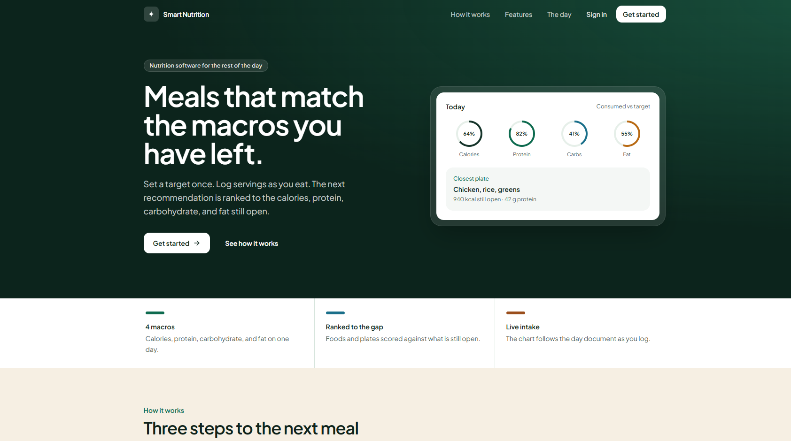
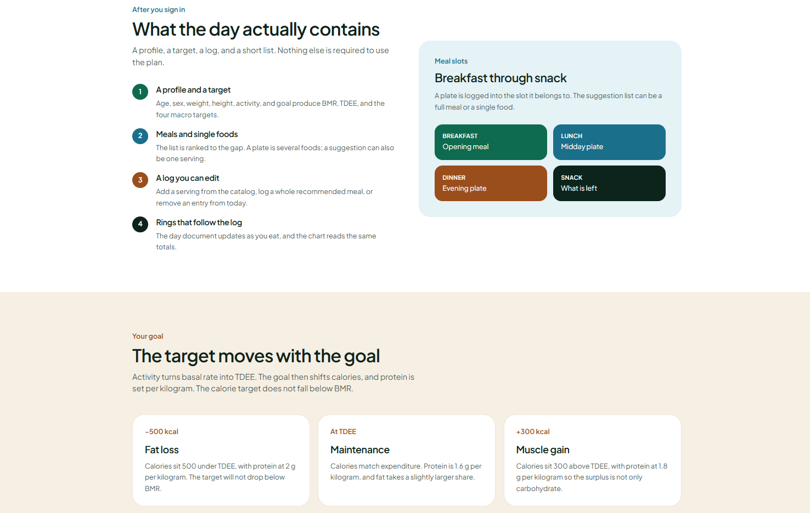
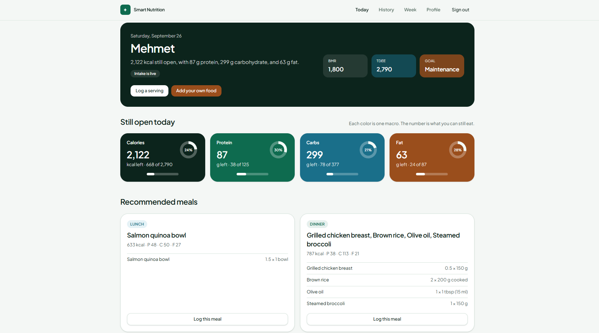
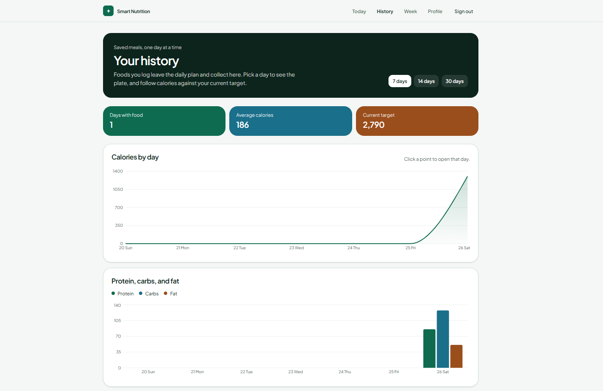
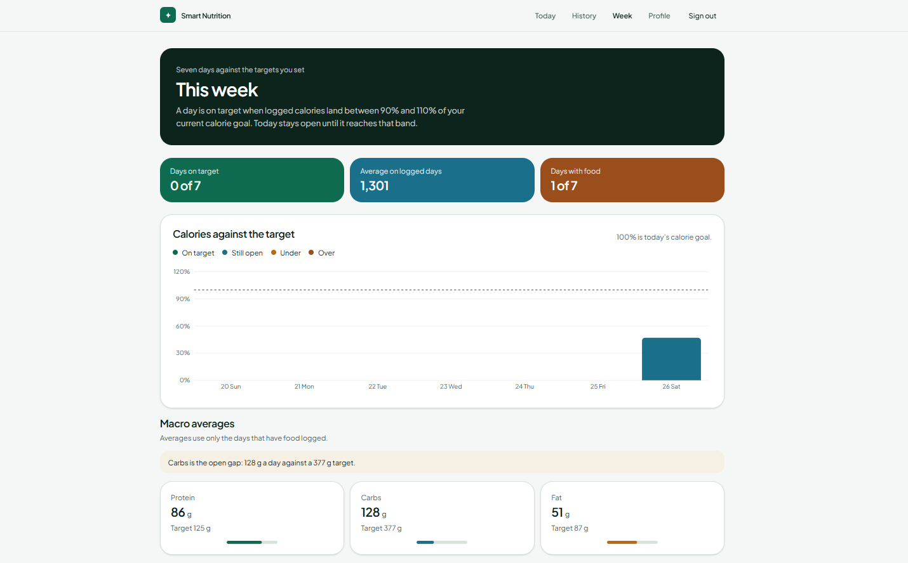

# Smart Nutrition Recommend

Daily calorie and macro targets, then meals ranked to what is still open.

You set age, sex, weight, height, activity, and a goal. The API turns that into a basal rate, a TDEE, and a budget for calories, protein, carbohydrate, and fat. As you log food, the day updates, and the next suggestion is the one that fits the gap.

**Live app:** [smart-nutrition-mu.vercel.app](https://smart-nutrition-mu.vercel.app)

## The product

The landing page is the promise: one target, a log, and a short list of what still fits.



Three steps carry the day.



## A day in the app

After sign-in, four pages share one navigation: **Today**, **History**, **Week**, and **Profile**.

**Today** is the plan. The banner shows BMR, TDEE, and the goal. Four cards show what is still open. Recommended meals and single foods are ranked against that remainder. You can log a catalog serving, log a whole plate, or add a food of your own.



**History** keeps the log off the plan. Foods are grouped by meal, and the charts run day by day for 7, 14, or 30 days.



**Week** scores the last seven days against the current calorie target. A day is on target between 90% and 110%. Today stays open until it reaches that band. The page also shows which macro is furthest behind, and how often each meal was logged.



## How a target is built

The calorie target never falls below BMR. Fat takes a share of the remaining energy, with a floor so the day does not collapse into protein alone. Carbohydrate is whatever calories are left.

Activity multipliers: sedentary `1.2`, lightly active `1.375`, moderately active `1.55`, very active `1.725`, extra active `1.9`.

## Stack

| | |
| --- | --- |
| Interface | React 19, Vite, Tailwind CSS, Recharts |
| Accounts | Firebase Authentication (email and password) |
| Day log | Firestore listener on `dailyIntakes/{profileId}_{date}` |
| API | Express 5, Firebase Admin |
| Targets and ranking | Computed on the server from the profile and today’s intake |

The signed-in user’s Firebase uid is the profile id. The browser sends the local calendar date (`YYYY-MM-DD`), not a UTC timestamp.

## Run it locally

Node.js 20 or newer.

```bash
cd backend
cp .env.example .env
npm install
npm run seed
npm run dev
```

```bash
cd frontend
cp .env.example .env
npm install
npm run dev
```

The API listens on [http://localhost:4000](http://localhost:4000). The app is at [http://localhost:5173](http://localhost:5173).

`backend/.env` needs a Firebase service account, either as `FIREBASE_PROJECT_ID`, `FIREBASE_CLIENT_EMAIL`, and `FIREBASE_PRIVATE_KEY`, or as `FIREBASE_SERVICE_ACCOUNT_PATH`. `frontend/.env` needs the web app keys from Firebase console → Project settings, plus `VITE_API_BASE_URL=http://localhost:4000/api`. Use `KEY=value` lines. Do not commit either file.

```bash
cd backend
npm test
```

## Layout

```
frontend/     React app
backend/      Express API, target math, and recommendation ranking
docs/images/  screenshots in this readme
```

Production serves the built interface and the API on one host. Requests under `/api` go to Express. Everything else is the Vite app. A day is on target in **Week** only after food is logged and calories sit between 90% and 110% of the current goal.
